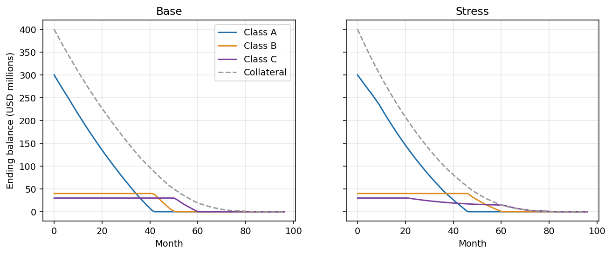
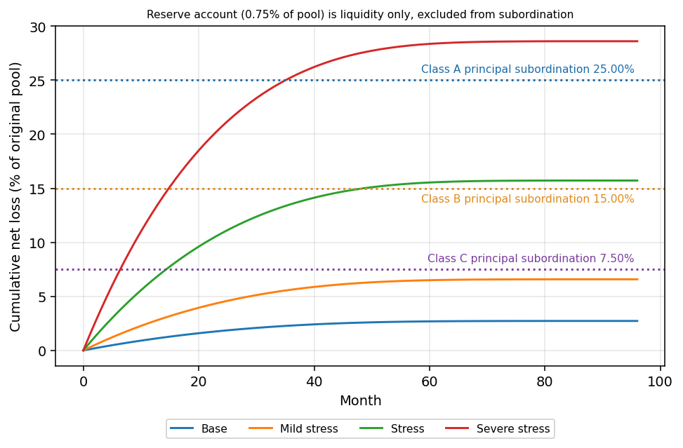
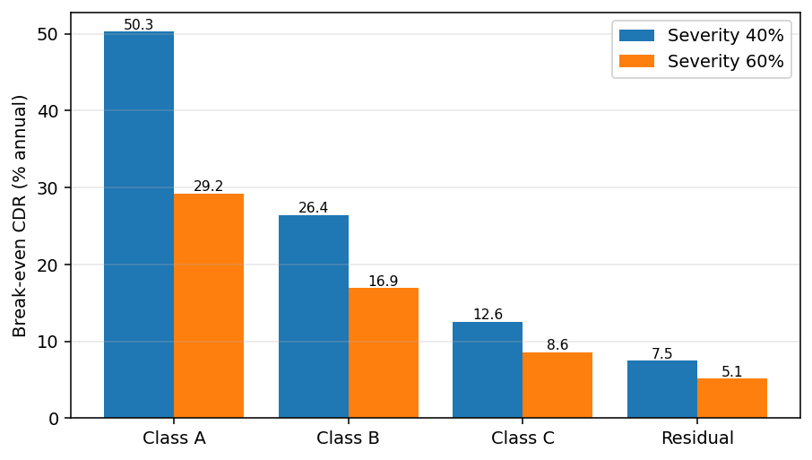

# Securitization Waterfall and Risk Retention Model

A generic structured-finance model: an amortizing collateral pool feeding a four-class capital structure through an explicit priority of payments, with overcollateralization (OC) and interest coverage (IC) tests, turbo cure, a reserve account, tranche write-downs, scenario and break-even analysis, and a module that sizes the 5% risk retention interest under US Regulation RR and EU Securitisation Regulation Article 6.

It is built twice from the same specification: a **Python package** (tested with pytest) and an **Excel workbook with live formulas**. A script recalculates the workbook headlessly in LibreOffice and reconciles it to the Python results.

**The collateral is synthetic.** The ten rep lines, the forward curve, the fees, the trigger levels, the fair value discount margins and the advance rates are all invented inputs chosen for illustration. Nothing here is market data or a real transaction.

## Contents

```
python/      waterfall/ package, tests/, outputs/ (CSV, JSON, charts), requirements.txt
excel/       build_workbook.py and securitization_waterfall.xlsx (about 23,800 live formulas)
docs/sources/  plain-text extracts of the regulations read for the retention module (see Sources)
```

Quick start (Windows shown; use `python` where `py -3` is not needed):

```
cd python
py -3 -m pip install -r requirements.txt
py -3 -m waterfall.cli               # regenerates every table, CSV and chart in python/outputs
py -3 -m pytest -q                   # 122 tests, about 70 seconds (the Excel reconciliation dominates); also runs from the repository root
cd ../excel
py -3 build_workbook.py              # rebuilds the workbook (embeds calculated values if LibreOffice is present)
cd ../python
py -3 -m waterfall.reconcile_excel   # recalculates the workbook in LibreOffice and compares to Python
```

## The deal

Pool (synthetic, 10 rep lines): USD 400.0 million, weighted average coupon 9.15%, weighted average remaining term 61.9 months, terms from 36 to 84 months. Monthly payment dates, 30/360 (rate divided by 12), interest accrues on beginning balances.

| Class | Original balance | Coupon | Principal subordination below it |
|-|-|-|-|
| A | 300.0m | index + 1.10% (floating) | 25.0% of pool |
| B | 40.0m | index + 2.25% (floating) | 15.0% |
| C | 30.0m | 7.50% fixed | 7.5% |
| R (residual) | 33.0m | none, receives all remaining cash | none |

The residual par equals pool balance plus the initial reserve account (3.0m, funded by the residual holder) less A, B and C, so it is 30.0m of principal plus the 3.0m reserve. Subordination is stated on principal only: it is the share of the original pool below each class (A 25.0%, B 15.0%, C 7.5%). The reserve (0.75% of the pool) is liquidity, not credit enhancement, because it can only pay fees and Class A and B interest and cannot absorb a principal write-down; it is released when the notes are retired, first to any carried note interest and then to the residual. Senior fees are 0.60% servicing plus 0.03% trustee, annual, on beginning pool balance. The floating index is an assumed curve, `4.30% + (3.25% - 4.30%) * (1 - exp(-t/24))`, not market data. Index timing: the coupon for period t is `fwd[t] + margin`, where `fwd[t]` is the curve value at month t, the end of the accrual period and the payment date, so the index is effectively set in arrears at the payment date rather than fixed in advance at the start of the period; the coupon accrues on the beginning balance. Day count is 30/360 (annual rate divided by 12, no actual-day accruals), and the discount factors in the analytics use the same `fwd[t]`. Notes are unhedged, so a rise in the index compresses excess spread (see the rate shock scenario).

### Collateral mechanics (per rep line, per month)

1. Defaults = beginning balance x MDR. MDR and SMM come from CDR and CPR by `1 - (1 - annual)^(1/12)`.
2. Interest = performing balance (beginning less defaults) x WAC / 12.
3. Scheduled principal = level-payment principal on the performing balance over the remaining term.
4. Prepayment = (performing balance less scheduled principal) x SMM.
5. Ending balance = beginning - defaults - scheduled - prepayment (reconciled every period, per rep line and in total).
6. Recoveries arrive `lag` months after default at (1 - severity) x defaulted balance. Net loss is recognized at default. Collateral value for the tests is ending balance plus recoveries still pending.

Collateral cash in = interest + scheduled principal + prepayments + recoveries.

### Priority of payments

Regular principal (available principal funds = scheduled + prepaid + recovered principal):

1. Class A, B, C principal, **sequential** (A, then B, then C) or **pro rata** by beginning balance. The pro rata mode is a one-way (latching) switch: from the period after the first test breach every later period is sequential, even if the tests cure.
2. Any excess after A, B and C are retired goes to the residual.

Tests are computed on pro forma balances (after regular principal, before turbo), so timing is consistent between collateral value and note balances:

* OC ratio for class k = (collateral value) / (balance of classes A through k). Triggers: A 1.25, B 1.12, C 1.045. Initial ratios are 1.333, 1.176 and 1.081.
* IC ratio for class k = (interest collections less senior fees accrued) / (interest accrued on classes A through k). Triggers: A 1.50, B 1.30, C 1.15.
* A class is in breach if either its OC or its IC ratio is below trigger.

Interest priority of payments (steps 1 to 10 run on interest collections only; the reserve draw is described below):

1. Senior fees.
2. Class A interest.
3. If the Class A tests are breached, all remaining interest is diverted to principal (turbo), A first, then B, then C.
4. Class B interest.
5. Turbo if the Class B tests are breached.
6. Class C interest.
7. Turbo if the Class C tests are breached.
8. Turbo to cure any principal deficiency (collateral value below note balances), up to the deficiency.
9. Reserve account top-up to target.
10. Remaining interest to the residual.

Unpaid fees and interest carry forward without interest on interest. After steps 1 to 10, the reserve account pays the senior fees, Class A interest and Class B interest (in that order, never Class C) that collections left unpaid, up to the account balance. A draw pays those items directly and is never swept into turbo or principal. Because a turbo diversion can leave Class B interest unpaid from collections, the reserve can pay Class B interest while collections go to Class A principal (this is what happens in the rate shock scenario below). The reserve is released when A, B and C are retired (paid off or fully written down). Once the notes are retired, any principal collections that would go to the residual and the reserve release first settle carried senior fees and then carried Class A, B and C interest, in that order, and only what is left reaches the residual. The residual is therefore never paid in a period that ends with fees or note interest unpaid, which is what 246.2 requires of the retained first-loss interest (see Risk retention). After turbo, any remaining principal deficiency is written down against C, then B, then A. Write-downs are permanent (no reinstatement).

Excess spread = interest collections - senior fees - interest accrued on A, B, C. It is tracked per period in dollars and annualized basis points of pool balance.

### Tranche analytics

* WAL: sum of (month x principal paid) / 12 / total principal paid. For R, principal paid means principal distributions plus the reserve release.
* Yield at par: annualized (monthly IRR x 12) of the cash flows against a purchase at par at closing. This is the same basis as the coupons.
* Discount margin: spread over the forward curve that prices the cash flows at par with monthly compounding (Python only).
* Principal window: first and last month with principal paid.
* Write-down: cumulative principal write-down for A, B, C. For R, par less total cash received (capital not returned). This measure ignores deferred interest.
* Unpaid interest: cumulative unpaid (deferred) interest per note, reported at the horizon and as the peak over any month. Any shortfall means a write-down or unpaid interest above USD 1 at any payment date (for R, capital not returned above USD 1).
* Break-even CDR: highest CDR (bisection, base CPR and lag) at which the tranche has no write-down above USD 1.

## Results

Every figure below was produced by the code in this repository (`py -3 -m waterfall.cli`) and is stored in `python/outputs/`.

### Base case (CPR 10%, CDR 3%, severity 40%, recovery lag 6 months)

| Class | WAL (yrs) | Yield at par | Discount margin | Principal window (months) | Interest paid | Loss |
|-|-|-|-|-|-|-|
| A | 1.62 | 4.996% | 1.100% | 1 to 42 | 24.21m | none |
| B | 3.84 | 5.972% | 2.250% | 42 to 51 | 9.16m | none |
| C | 4.61 | 7.500% | 3.824% | 51 to 60 | 10.38m | none |
| R | 5.58 | 16.83% | 13.12% | 60 to 90 | 32.08m | none |

No test is breached in the base case. Cumulative net loss at the horizon is 2.73% of the original pool. Excess spread is about 327 basis points annualized in month 1.

### Scenario grid

The grid is reported on two bases. First, principal write-downs only: write-down is a percentage of original class balance (R: capital not returned); "Junior-most write-down" is the most junior class with a write-down (the first to absorb a loss) and "Most senior write-down" is the most senior class with a write-down.

| Scenario | CPR | CDR | Severity | Lag | Index shift | A | B | C | R | Junior-most write-down | Most senior write-down |
|-|-|-|-|-|-|-|-|-|-|-|-|
| Base | 10% | 3% | 40% | 6 | 0 | 0 | 0 | 0 | 0 | none | none |
| Mild stress | 10% | 6% | 50% | 6 | 0 | 0 | 0 | 0 | 0 | none | none |
| Stress | 6% | 12% | 60% | 9 | 0 | 0 | 0 | 52.9% | 73.2% | R | C |
| Severe stress | 4% | 20% | 70% | 12 | 0 | 0 | 79.6% | 100% | 93.9% | R | B |
| Fast prepay | 30% | 3% | 40% | 6 | 0 | 0 | 0 | 0 | 0 | none | none |
| Rate shock | 10% | 6% | 50% | 6 | +300bp | 0 | 0 | 0 | 46.7% | R | R |

Second, including deferred interest. The write-down basis understates damage when interest is deferred, so the grid also reports cumulative unpaid interest per note (ending at the horizon, and the peak over any month, in USD) and two labels that count a write-down or unpaid interest as a shortfall: "Most senior with any shortfall" and "First class with any shortfall", the most junior class with any shortfall, which is the first in the order shortfalls are absorbed (R, then C, B, A).

| Scenario | Unpaid interest at horizon A / B / C | Peak unpaid interest A / B / C | Most senior with any shortfall | First class with any shortfall |
|-|-|-|-|-|
| Base | 0 / 0 / 0 | 0 / 0 / 0 | none | none |
| Mild stress | 0 / 0 / 0 | 0 / 0 / 0 | none | none |
| Stress | 0 / 0 / 0 | 0 / 0 / 813 | C | R |
| Severe stress | 0 / 0 / 689,935 | 0 / 0 / 1,631,216 | B | R |
| Fast prepay | 0 / 0 / 0 | 0 / 0 / 0 | none | none |
| Rate shock | 0 / 0 / 0 | 0 / 0 / 2,812,500 | C | R |

In the rate shock scenario the write-down basis names only R, but Class C receives no interest for 15 months (peak unpaid 2.81m) and only catches up afterwards. In months 1 to 9 the Class A tests are breached and collections after Class A interest go to Class A principal; Class B interest in those months is paid by the reserve (2.81m drawn, leaving 0.19m in the account), which is why B shows no shortfall. The credit assumptions equal Mild stress, yet the floating notes reprice up against fixed-rate collateral, tests breach in 15 months, and the residual loses 46.7% of its capital: an unhedged basis risk. A denser CDR by severity grid (CDR 0% to 40%, severity 30%, 50%, 70%) with the same columns is in `python/outputs/loss_grid_cdr_severity.csv`. Once the notes are retired, principal collections and the reserve release settle carried interest before the residual, so in the Stress run 818 USD of the 3.0m reserve release settles Class C interest before the remaining 2.999m reaches the residual, and in Severe stress the whole 0.94m release goes to Class C interest and the residual receives none of it; Severe stress still ends with 0.69m of Class C interest unpaid because the cash runs out. A small non-monotone corner remains at severity 70%: the residual loss is 96.9% at 30% CDR and 95.8% at 40% CDR. At 40% CDR the reserve is drawn less, so 1.22m is released against 0.45m at 30%, and after carried interest is settled 0.42m of it reaches the residual (nothing does at 30%). The monotonicity test therefore checks the residual only up to 30% CDR.

### Break-even CDR (annual, base CPR 10%, lag 6 months)

| Severity | Class A | Class B | Class C | Residual |
|-|-|-|-|-|
| 40% | 50.3% | 26.4% | 12.6% | 7.5% |
| 60% | 29.2% | 16.9% | 8.6% | 5.1% |

Higher severity cuts every break-even sharply, and the ordering (A above B above C above R) holds at both severities.

### Charts







In the loss chart, a scenario curve above a class principal subordination line (A 25.00%, B 15.00%, C 7.50% of the original pool) means collateral net losses exceed the principal credit enhancement below that class. The 0.75% reserve is shown separately in the chart title and is not counted in the lines, because it cannot absorb a principal write-down. Cumulative net loss at the horizon is 2.7% (Base), 6.6% (Mild stress), 15.7% (Stress) and 28.6% (Severe stress) of the original pool. Excess spread and turbo divert cash to principal, so write-downs are smaller than the gap to subordination suggests: Severe stress ends above the Class A line (25.00%) and Class A is still repaid in full.

## Risk retention

Retained amounts are computed from base-case tranche fair values. Fair value here is the present value of each class's base-case cash flows at the forward curve plus an assumed margin (A +1.10%, B +2.75%, C +4.50%, R +12.00%). This is an illustrative discounted cash flow, not a GAAP fair value measurement. Base fair values: A 300.00m, B 39.32m, C 29.22m, R 33.97m; total 402.51m against 403.00m of par across all four ABS interests.

### Structure of the horizontal options

17 CFR 246.2 defines an eligible horizontal residual interest as an ABS interest (1) in a single class or multiple classes, (2) for which, when the issuing entity cannot pay all interest or principal due, "any resulting shortfall will reduce amounts payable to the eligible horizontal residual interest prior to any reduction in the amounts payable to any other ABS interest, whether through loss allocation, operation of the priority of payments, or any other governing contractual provision (until the amount of such ABS interest is reduced to zero)", and (3) that "has the most subordinated claim to payments of both principal and interest by the issuing entity". A pro rata share of the residual class held alongside third-party holders shares losses with them, so it would not meet condition (2). The horizontal and L-shaped options are therefore modelled with the residual class R split into two separately identified subclasses (an analytical construct, not a documented deal term):

* **R1**, retained, the first-loss subclass. It receives whatever residual cash remains after R2 is paid.
* **R2**, sold, a priority claim on all residual cash. Its par is carved out of R's par, and its unpaid claim accrues at forward index + 12.00% (the residual fair value margin) per month.

Any shortfall of residual cash therefore reduces R1 first, and R2 is paid before R1. Residual cash itself only exists after carried fees and note interest are paid in full (see Priority of payments), so a shortfall on the notes is also absorbed by the residual before any other interest. Because R2 accrues at the same rate it is discounted at, par is its fair value whenever it is repaid in full, as it is in the base case (a test checks this), so the fair value of R1 is the fair value of R less the par of R2. R2's par is set so that R1's fair value equals the required horizontal fair value, which is 5% of the fair value of all ABS interests, 20.126m, for the horizontal option (R2 par 13.841m, which is R's fair value less the required amount). For the L-shaped option R1's fair value is 10.321m (R2 par 23.645m), for the reason given below. If the residual alone could not cover a requirement, whole junior notes would be added (C, then B, then A). A partial holding of any class is never used for a horizontal position. In the vertical and EU options R1 simply denotes the whole residual and R2 is empty.

Under 246.4(a)(3) the percentage of fair value in the horizontal interest plus the percentage of the vertical interest must equal at least five. 17 CFR 246.2 defines an eligible vertical interest as an interest in each class of ABS interests that constitutes the same proportion of each such class. R1 is a separately identified class, so the 2.5% vertical interest includes 2.5% of R1, and only the other 97.5% of R1 counts as the horizontal interest (the preamble to the final rule, 79 FR 77644 and its footnote 135, says the same for a vertical interest alongside a horizontal one in the CMBS option: the sponsor must hold a portion of the horizontal interest as part of the vertical interest). Counting the whole of R1 as horizontal as well would count that 2.5% slice twice and land at 4.94%. To reach exactly 5.00% the horizontal piece must have fair value 2.5% of the total, so 0.975 x FV(R1) = 0.025 x 402.512m and FV(R1) = 10.321m, which implies R2 par of 23.645m. The retained L-shaped position is 2.5% of each of A, B, C and R2 plus all of R1, and its fair value is 5.00% of the total fair value, equal to the regulatory measure (2.5% vertical plus 97.5% x 10.321m / 402.512m = 2.5% horizontal).

| Option | What is retained | Par retained | Fair value retained |
|-|-|-|-|
| US Reg RR vertical, 17 CFR 246.4(a)(1) | 5% of every class (A, B, C and the residual) | 20.150m | 20.126m |
| US Reg RR horizontal, 246.4(a)(2) | All of R1, the first-loss subclass (19.159m par); R2 (13.841m par) is sold | 19.159m | 20.126m |
| US Reg RR L-shaped, 246.4(a)(3) | 2.5% of each of A, B, C and R2 (R2 par 23.645m) plus all of R1 (9.355m par) | 19.196m | 20.126m |
| EU Art 6(3)(a) vertical | 5% of the nominal of each tranche (all four treated as sold to investors) | 20.150m | not applicable |
| EU Art 6(3)(d) first loss | the whole residual, 33.000m par (30.0m of principal, 7.5% of the pool, plus the 3.0m reserve funding), above the 5% needed | 33.000m | 33.966m |

The 33.000m of EU first loss par includes the 3.0m reserve funding, which cannot absorb principal losses, so the 5% test rests on the 30.0m of principal alone: 7.5% of the 400.0m pool, above the 5% needed, and the conclusion (whole residual qualifies with room to spare) is unchanged.

Other amounts: the eligible horizontal cash reserve account alternative under 246.4(b) is funded at the required horizontal fair value, 20.126m. EU 6(3)(c) (randomly selected exposures) and 6(3)(e) (first loss exposure of 5% of every exposure) each equal 5% of the pool nominal, 20.000m; they are sized but not cash-flow modelled, and 6(3)(c) needs at least 100 potentially securitised exposures at origination, which a 10 rep line pool cannot show.

### Retained-position return (cost basis is par)

| Option | Base yield | Stress yield | Base cash received | Stress cash received |
|-|-|-|-|-|
| RR vertical (same as EU vertical) | 7.07% | 0.71% | 23.40m | 20.46m |
| RR horizontal (R1) | 16.92% | n/a, no cash received | 38.75m | 0.00m |
| RR L-shaped | 14.78% | -24.90% | 35.38m | 10.23m |
| EU first loss (whole R) | 16.83% | -27.87% | 54.18m | 8.83m |

Stress is CPR 6%, CDR 12%, severity 60%, lag 9. Sizing is fixed at closing on base fair values and is not re-run under stress. In stress all of the residual's 8.83m of cash goes to R2 (13.84m claim), so the retained first-loss subclass R1 receives nothing while R2 receives 8.83m against its 13.84m par. The vertical strip keeps a positive return under stress because it holds 5% of the senior classes that do not lose; the horizontal and first-loss positions concentrate the loss.

### Financing view (illustrative)

Advance rates by class: A 85%, B 70%, C 55%, R 30% (applied to both R1 and R2), at forward index + 2.75%. All retained cash flows sweep to the lender until repaid. Coverage is the present value of retained cash flows at the financing rate divided by the advance.

| Option | Advance | Advance / cost | Coverage base | Coverage stress | Repaid (base / stress) |
|-|-|-|-|-|-|
| RR vertical | 15.47m | 76.8% | 1.32x | 1.15x | month 37 / month 46 |
| RR horizontal | 5.75m | 30.0% | 5.11x | 0.00x | month 27 / not repaid, 9.47m unpaid |
| RR L-shaped | 10.47m | 54.5% | 2.57x | 0.85x | month 60 / not repaid, 2.55m unpaid |
| EU first loss | 9.90m | 30.0% | 4.46x | 0.76x | month 11 / not repaid, 3.84m unpaid |

17 CFR 246.12(e) prohibits a retaining sponsor from pledging a required retained ABS interest unless the obligation is with full recourse to the sponsor. So any "unpaid" balance above (loan balance including accrued interest at the horizon) is a claim against the sponsor, not a loss the lender could absorb by seizing the retained interest. This view is an economic coverage illustration, not a compliant financing structure.

## Excel workbook

`excel/securitization_waterfall.xlsx`, sheets: Inputs, Pool, Waterfall, Tests, CashFlows, Retention_CF, Retention, Scenario_Summary. Typed numbers are on Inputs, plus a short list of structural constants elsewhere. The time-series sheets (Pool, Waterfall, Tests, CashFlows, Retention_CF) hold formulas, the integer period index, zero opening seeds (balances, carried shortfalls, sequential flag, cumulative totals; row 5 only) and the starting discount factors of 1 (Retention_CF row 5). The Retention sheet holds seven literal zeros (cells F15, G15, F16, F18, G18, F19 and G19: the R2 fraction and the R2 par carve-out where an option has no R2), and Scenario_Summary holds three (F10, M10 and N10: the R row of the ending balance and unpaid interest columns). A test allows exactly those cells and nothing else. Change the scenario number on Inputs (row "Selected scenario number") and every sheet recalculates. Pool has ten rep line blocks with beginning balance, defaults, interest, scheduled principal, prepayment and ending balance; Waterfall has the priority of payments step by step; Tests has OC and IC ratios, breach flags and excess spread; Retention sizes all five options (fractions of A, B, C, R1 and R2 held, and the R2 par carved out of R), with the R2 priority claim and the financing sweep in Retention_CF; Scenario_Summary shows the tranche metrics, unpaid interest and any-shortfall flags, the four class labels, and the integrity checks for the selected scenario.

Retention sizing in Excel follows the selected scenario's fair values unless the optional "Locked fair value" cells on Inputs are filled (paste base-case values there to fix sizing at closing while viewing stress). Break-even CDR and discount margin are not in Excel (no live solver); they are Python outputs, and the reconciliation probes the break-even point through the workbook.

### Reconciliation of Excel to Python

`py -3 -m waterfall.reconcile_excel` opens the workbook, sets the scenario selector, recalculates in headless LibreOffice, reads the results back and compares them to the Python model. It covers the six scenarios, three extra runs in pro rata mode (Base, Stress, and Rate shock, which breaches and then cures, so it exercises the latching switch), two extra scenarios that exercise the post-retirement arrears sweep (CPR 2%, CDR 18%, severity 20%, lag 12; and CPR 10%, CDR 40%, severity 70%, lag 6), and a break-even probe. Compared: every tranche cash flow in every period, the arrears sweep and residual cash in every period, interest and principal totals, write-downs, unpaid interest and any-shortfall flags, the four class labels, WAL, yields, live fair values, the retention fractions and R2 par, retained amounts, the regulatory measure, retained yields, financing figures, breach month counts and the workbook's own check cells.

Stated tolerances: USD 0.01 for dollar amounts and each cash flow cell; 1e-6 for WAL (years) and annualized yields; 1e-5 for levered IRR; 1e-9 for retention fractions. Result of the last run (11 scenario recalculations and 2 break-even probe recalculations): all passed, with worst absolute differences of 5.0e-8 USD on cash flows, 1.8e-7 USD on dollar totals, 3.5e-10 USD on the arrears sweep, 5.1e-9 USD on residual cash, 7.1e-15 years on WAL and 2.9e-12 on yields. Break-even probe on Class C: Python break-even CDR 12.5676%. Set in Excel at 0.995 times that CDR the Class C loss is USD 0; at 1.005 times it is USD 255,905.95 in Excel and USD 255,905.95 in Python. The full report is `python/outputs/excel_reconciliation.json`.

Honest caveats: recalculation was verified in LibreOffice only, not in Microsoft Excel. Two functions (`MINIFS`, `MAXIFS`, used for the principal window) need Excel 2019 or later. The committed workbook was round-tripped through LibreOffice so it carries calculated values; the creator property is set to the author name.

## Integrity checks (run for every scenario)

* Pool balance reconciliation each period and per rep line (max absolute difference 1.2e-7 USD).
* Lifetime pool identity: original balance = scheduled + prepaid + defaulted + ending balance.
* Cash conservation each period: fees + note interest + note principal + residual cash + change in reserve = collateral cash in (max 3.7e-9 USD).
* Fees plus note principal and interest paid never exceed collateral cash plus reserve draws and releases.
* The residual is never paid in a period that ends with carried fees or note interest unpaid (zero such periods in every scenario).
* Per class: principal paid + write-downs + ending balance = original balance (max 1.2e-7 USD).
* Every reserve draw is fully applied to fees, Class A interest or Class B interest (max absolute difference 0).
* No negative balances, payments or reserve.

## Sources

Regulatory text was read from primary sources on 2026-09-30 and saved as plain-text extracts in `docs/sources/` (each file starts with its source URL and retrieval date).

* **US, 17 CFR Part 246 (Regulation RR)**: eCFR API text of sections 246.2 (definitions of ABS interest, eligible vertical interest, eligible horizontal residual interest), 246.3 (base requirement), 246.4 (standard risk retention: (a)(1) vertical not less than 5 percent; (a)(2) horizontal at least 5 percent of the fair value of all ABS interests under a GAAP fair value framework; (a)(3) combination whose percentages equal at least five; (a)(4) determined at closing; (b) cash reserve account; (c) disclosures, including discount rates, loss given default, prepayment rates, default rates, lag between default and recovery, and the basis of forward rates) and 246.12 ((a) transfer, (b) hedging, (e) full-recourse financing). Sections 246.2 and 246.4 were re-read on 2026-09-30 against the eCFR issue of 2026-09-28 (the latest available that day); the eCFR versions API shows no amendment to these sections since 2016-12-31. The eCFR API needs compressed transfer enabled on the request (curl's compressed option); without it the API answers HTTP 406.
* **EU, Regulation (EU) 2017/2402, Article 6**: the Publications Office consolidated text dated 09.04.2021 (`https://publications.europa.eu/resource/celex/02017R2402-20210409`, requested with an `Accept: application/xhtml+xml` header). Article 6(1): not less than 5%, measured at origination, not subject to credit risk mitigation or hedging; the retainer must also take into account any fees that may in practice be used to reduce the effective material net economic interest (a sentence added by Regulation (EU) 2021/557, marked M1 in the consolidated text; not modelled here, since the synthetic deal has no such fees). Article 6(3)(a) to (e): 5% of the nominal of each tranche sold or transferred to investors; revolving exposures; randomly selected exposures (at least 100 at origination); first loss tranche (plus other tranches if needed to reach 5% of the nominal of the securitised exposures); first loss exposure of at least 5% of every securitised exposure. The EUR-Lex website pages returned a bot-challenge response (HTTP 202, empty body), which is why the Publications Office endpoint was used. Amendment check: the Publications Office Cellar SPARQL endpoint lists Regulation (EU) 2021/557 (CELEX 32021R0557) as the only act amending Regulation 2017/2402, and 09.04.2021 as the latest consolidated version (the only earlier consolidated version is dated 28.12.2017), at the time of this review (2026-09-30).
* **EU risk retention technical standards, not modelled**: Commission Delegated Regulation (EU) 2023/2175 of 7 July 2023 supplementing Regulation (EU) 2017/2402 with regard to regulatory technical standards specifying in greater detail the risk retention requirements for originators, sponsors, original lenders and servicers (OJ L, 18.10.2023), adopted under Article 6(7). Title and number were checked against the Publications Office text (`https://publications.europa.eu/resource/celex/32023R2175`, extract in `docs/sources/eu_2023_2175_extract.txt`). It specifies how each Article 6(3) option is to be fulfilled, for example synthetic and contingent forms of retention, measurement of the level of retention, retention of a first loss tranche (its Article 7(2) lets the retainer hold a pro rata portion of a first loss tranche larger than 5% if that portion is at least 5% of the nominal of the securitised exposures) and the ban on hedging or selling the retained interest. None of this is modelled here: the EU sizing above follows Article 6(3) only and retains the whole residual for the first loss option.

Not verified (UNVERIFIED): whether Delegated Regulation 2023/2175 has itself been amended (the Cellar query found no amending act, but Cellar can lag the Official Journal); the UK securitisation retention regime (a separate onshored rule set) was not fetched or modelled, and the EU sizing here must not be read as a UK compliance calculation; Reg RR exemptions and other retention options (sections 246.5 to 246.11, for example qualified residential mortgages and revolving pool structures) are not modelled; the same joint rule also appears in banking agency codifications (for example 12 CFR Part 244), which were not read.

## Limitations

* The collateral is synthetic: ten rep lines with constant CPR and CDR, not loan-level data, and no seasoning curves.
* Delinquencies and servicer advances are not modelled; defaults go straight to a lagged recovery.
* Fees and coupons use a simplified 30/360 monthly convention with no payment lag between collection and payment dates.
* Notes are unhedged, and the discount margins, advance rates, triggers and forward curve are illustrative assumptions.
* Fair values for retention sizing are a discounted cash flow at assumed margins, not a GAAP fair value measurement, and no disclosure package is produced.
* Retention logic covers the standard options only. Vertical slices are pro rata shares of every class; horizontal positions are whole classes or the separately identified first-loss residual subclass R1, whose split from R2 is an assumed structure (R2 priced at par and accruing at forward + 12.00%). It does not test who the retainer is, majority-owned affiliate rules, or the hedging and transfer restrictions beyond describing them.
* The turbo diversion ranks ahead of Class B and C interest, so in a prolonged Class A breach those classes depend on the reserve, then defer; this is a property of the assumed priority of payments, not a recommendation for deal terms.
* No tax, accounting, or legal analysis. Nothing here is investment advice or a compliance opinion.
